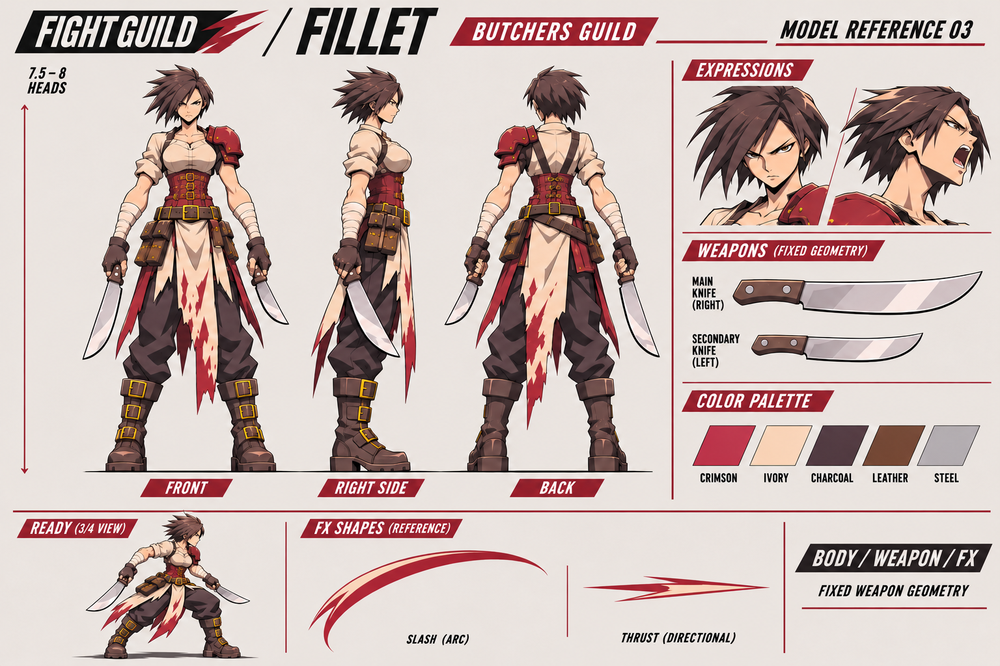
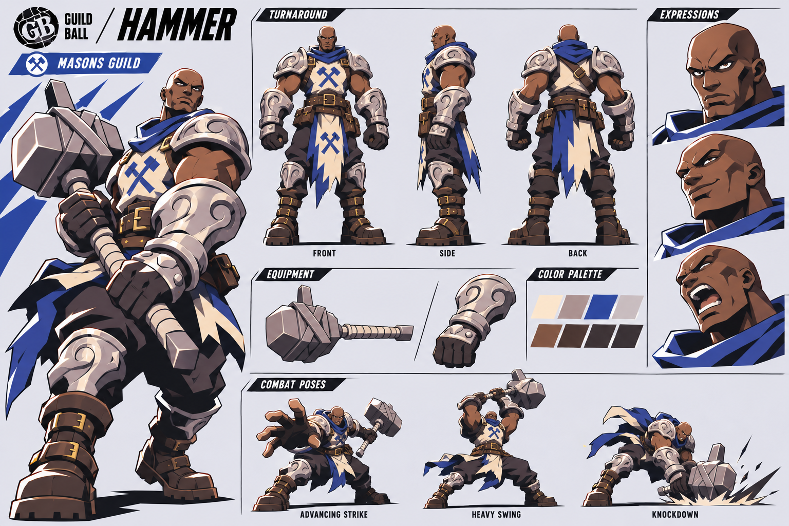

# Fight Guild

A native **Godot 4.6.3** fighting-game lab for iterating toward a PC/PS5 game. The PC build includes **Anvil, Hammer, Smoke, Tapper, Shark and Fillet**, generated sprites, all five basic **P / K / S / Hs / D** buttons, unified gatlings, a move editor, Momentum/Faultless Defense, counter/punish/reversal feedback and experimental direct rollback multiplayer.

Each fighter has matching **windup and active** pose studies plus movement poses and three two-frame block reactions. Open **Development → Sprite review** to compare actions at the same scale. These are provisional kits and images. The [sprite production contract](docs/sprite-production.md) and [backlog](docs/backlog.md) cover consistent palettes, silhouettes, smear shapes, future characters and eventual windup → active → impact → follow-through → recovery sequences.

**Fillet versus Shark** is the default matchup. Recovery editing includes independent grounded/airborne knockback, block pushback, launch and soft/hard knockdown. Universal **2D** sweep and **4P+K / 6P+K** throws cause hard knockdown. Combo gravity begins after five hits by default; Velocity-driven wall impacts deplete independent hidden wall pools; the next impact splats, a follow-up breaks the wall, and the attacker earns Momentum Positive Bonus. See [recovery and walls](docs/recovery-and-walls.md) for editable values and prototype limits.

Fillet has **236K** knife spiral and **236S > 6S > 2S** rekka, with **236S > 2S** as the shortcut. Shark has **214S / j.214P** diagonal hook pulls and **P** on-hit stabs. Both have dedicated generated windup/active art. Most fighters run forward; Anvil and Tapper step. Run/step velocity carries into attacks, including motion commands. Tune these in Development; [signature moves and movement](docs/signature-moves.md) lists the inputs and settings.

Body-only hurtboxes follow all **279 current poses**, using **legs, torso-and-arms, head, and at most one optional extension**—four boxes maximum. Per-fighter pushboxes and preliminary stats/hitboxes cover **258 move slots (158 enabled in the current workshop draft)**. **Weapons never extend hurtboxes; attack startup is at least 5 frames.** Development overlays and Sprite review show the actual collision geometry. See [collision rules](docs/collision-rules.md) and [move stats](docs/move-stats.md).

Menus share the supplied **Guild Ball** visual language: Barlow Condensed, charcoal panels, raised blue controls and brass trim. Character select adds a central angled roster and large guild-colored fighters, following the requested 2XKO-inspired direction. Versus fills the screen with generated Fillet/Shark face portraits, guild-colored health rails with names inside, an open timer dial, diamond Scrum markers and floating three-section Momentum. The stage floor and fighters share one camera projection, with body contact shadows and readable outlined combo numerals. Menus use interruptible eased transitions, with a saved reduced-motion option. Controls uses its separate warm Settings skin. [Menu style and provenance](docs/menu-style.md) records the reusable assets and review workflow.

**Tapper’s new kit is playable:** Leo-derived normals, close/far Slash, held guard, air throws and a no-block rolling stance. **5D / ground throw** enters; stance **S** self-chains, **Hs** is overhead, **2D** exits and **236D** runs into a tackle and single punch. New ready/rolling idles, walk and step-dash sprites accompany 64 attack drawings. [Full kit, frame data and editor instructions](docs/tapper-design.md).

## Play or edit

For browser-only attack tuning on a work PC, download **FightGuild-Move-Workshop.html** from the **FightGuild-Move-Workshop** Actions artifact. It includes the artwork, draggable hitboxes and per-attack hurtboxes, saves a browser draft and exports JSON for the Godot editor. Art briefs can include pose-reference photos and captions, embedded in the same JSON. Workshop exports need the updated schema-18 game; version-12–17 workshop files migrate automatically. No game install is needed to use the page. [Move Workshop guide](docs/move-workshop.md) covers editing, backups, art notes and building the page.

Download the Windows/Linux ZIP from this branch's successful GitHub Actions artifacts, extract the whole folder and run its executable. For the editable project archive, import `godot/project.godot` in Godot 4.6.3. [Native play guide](docs/play-native.md) covers controls, saves, editing and direct online play.

- Versus is first to two Scrum wins: **1st Scrum**, **2nd Scrum**, and **Final Down** at 1–1. Fighter loading/intros and the four-beat opening lead into each match; online clients synchronize before release.
- Start from **Versus**, **Training** or **Development**, then choose fighters. Esc / gamepad Start opens the match menu. [Menu flow](docs/menu-flow.md) explains entry, pause, rematch and connection recovery.
- **Player 1:** WASD; J/K/L/I/O = P/K/S/Hs/D; Space = run/dash; left Shift = simple modifier; back + Q = Faultless Defense.
- **Player 2:** arrows; numpad 1/2/3/5/6 = attacks; numpad 0 = run/dash; numpad + = modifier; back + numpad Enter = Faultless Defense.
- Choose simplified inputs independently at fighter select. Traditional motions stay available.
- In **Training**, use **Record**, **Replay** and **Frame lab** to inspect both fighters, cancel windows, input age, spacing and damage scaling. P2-only replay lets you practice against a recorded exchange; [training lab](docs/training-lab.md) explains the controls.
- In **Development**, edit any fighter, Apply & reset, then Save locally or export JSON. Old schema-1–17 saves preserve edits during migration; Restore default move set loads the new starter tuning.
- Online: direct ENet/UDP host and join, default port 7000. Both players use Player 1 controls locally. Matching move data is required.

Momentum has **three equal sections**, with continuous gain and separately editable ground/air FD costs. Try **Start Momentum: 50%** and the **Faultless guard** dummy in training. The move editor exposes chip damage and **Guard break on block**; Sprite review includes negative/even, positive and guard-break clips. [Momentum and defense rules](docs/momentum-defense.md) describe the provisional tuning. Negative Penalty is deferred; FD is the only meter spend.

Combos now appear as large background numerals on the attacker's current side. **Attack loop** and **Guard → reversal** training dummies help test counter hits, recovery punishes and first-frame reversals. Counter freeze, defender-only slowdown, bonuses and reversal eligibility are editable per move. Medium/large counters use oversized italic callouts, and large counters briefly push the camera in. See [combo and timing rules](docs/combat-feedback.md).

The [combat tuning editor](docs/combat-tuning.md) now supports cancel windows, starter and progressive damage scaling, jump startup, landing recovery, attack/counter presets, block carryover, five-frame post-stun throw protection and grounded wall priming. Guard break retains its throw vulnerability and backdash restriction. Blocking has no Just Guard or Instant Block timing requirement.

## Develop on Linux

Needs Git, curl, Python 3 with pip, a C++17 compiler and standard Linux Godot runtime libraries. Setup installs a pinned editor if needed, SCons and godot-cpp bindings in `FIGHT_TOOLS`, then builds and tests. The cloud default is `/workspace/.fight-guild-tools`; elsewhere set `FIGHT_TOOLS` to an absolute writable path outside the checkout.

```bash
bash scripts/setup.sh
bash scripts/godot.sh --editor
# Or launch the game directly:
bash scripts/godot.sh
```

After C++ changes, run `bash scripts/build-godot.sh`. When changing collision authoring, default move data or atlas pivots/body scale, first run `python scripts/generate-combat-data.py`, then rebuild the extension. Ordinary GDScript/presentation changes need no native rebuild. Validate with `bash scripts/test-godot.sh`.

To export, install templates and build the Windows library with MinGW-w64 (setup builds the Linux library):

```bash
bash scripts/install-godot.sh --templates
bash scripts/build-godot.sh target=template_release
bash scripts/build-godot.sh platform=windows
bash scripts/build-godot.sh platform=windows target=template_release
bash scripts/export-godot.sh
```

`build/` receives Windows and Linux ZIPs plus an editable Godot project ZIP containing available extension binaries. `bash scripts/export-godot.sh Linux` packages only Linux. `mingw_prefix=/absolute/toolchain/prefix` selects a relocated MinGW toolchain. The template download is approximately 1.2 GB; only four PC templates are installed.

## Implementation and limits

The shared C++ core runs at 60 fixed ticks with integer state, independent of presentation. [Architecture](docs/combat-architecture.md) explains native instances, rollback, versioned data and future 3D integration. [Combat rules](docs/combat-rules.md) separates confirmed design from defaults.

Linux rendering, keyboard gameplay, all 30 basic attacks, editing, save migration, sprites, latency/jitter correction and two UDP processes are tested. Windows is cross-compiled/exported and needs hardware playtesting. PS5 requires approved console access and Godot port tooling; no PS5 build is included. Strive input-buffer parity is a future measurement task.

The browser combat harness is retained for regressions: `bash scripts/setup-web.sh`, then `npm test`. The separate [Move Workshop](docs/move-workshop.md) provides portable attack authoring; Godot remains the game client and delivery path.

The [Move Workshop control guide (PDF)](exports/FightGuild-Move-Workshop-Guide.pdf) covers the earlier base controls. The [current Workshop guide](docs/move-workshop.md) includes later movement, projectile, Drive and stance controls; [Tapper’s guide](docs/tapper-design.md) includes his complete kit and tuning notes.

## Current reference guides

These are the latest character references. Fillet and Shark's **reference 05** set keeps the mature athletic proportions and matched rendering rules, selects **A / Stalker** for Fillet's standard combat stance, selects **F / Shoulder Rest** for Shark, and gives him blue sports glasses with long, lower-volume white hair. These drawing references guide sprite production; they are not runtime atlases or actual 3D assets. Their selected ready poses and separate eight-frame walk/run loops are now playable.

| Anvil | Smoke | Tapper |
| --- | --- | --- |
| [](art/characters/anvil.png) | [](art/characters/smoke.png) | [](art/characters/tapper.png) |

| Shark | Fillet | Hammer |
| --- | --- | --- |
| [](art/characters/shark.png) | [](art/characters/fillet.png) | [](art/characters/hammer.png) |

[Download the six-page reference PDF](exports/character-reference-guides.pdf).

For the first matchup: [Fillet action sheet](art/characters/fillet-actions.png),
[Shark action sheet](art/characters/shark-actions.png), and the
[four-page model/action PDF](exports/FightGuild-Fillet-Shark-References-v5.pdf).
[Reference rules and move-editor handoff](docs/fillet-shark-references.md) cover
palette, equipment, root travel, phased hitboxes, hurtboxes and pose-photo briefs.

Fillet's selected standard stance is **A / Stalker** from the
[six-option sheet](art/characters/stance-studies/fillet-01.png). The later
[B/F spacing refinements](art/characters/stance-studies/fillet-02.png) remain
exploration history; the A selection supersedes that narrower-base direction.

[Open the offline movement preview](exports/FightGuild-Movement-Preview.html)
for both selected stances, eight-frame walk/run loops, mirroring and hurtboxes.
In Godot, use **Development → Sprite & collision review → Walk / Run** to play
or scrub the same frames. The Move Workshop's approach preview also uses them.
Existing swing trails have a generated **3x thickness** pass; attack reach and
hitboxes are unchanged. [Production notes](docs/sprite-production.md) record
source prompts, collision fits and the remaining attack-art consistency work.

## Project notes

- [Game concept and roster](docs/game-concept.md)
- [Visual direction and review criteria](docs/art-direction.md)
- [Miniature sources and equipment notes](references/README.md)
- [Earlier visual explorations](art/archive/README.md)
- [Asset provenance and checksums](art/asset-manifest.json)

## Repository layout

```text
godot/                 Native project, UI, generated sprites and tests
native/                GDExtension adapter and build configuration
core/                  Deterministic C++ simulation
scripts/               Setup, build, tests and PC packaging
tests/                 Core, network and archived browser checks
docs/                  Rules, architecture, play guide and art pipeline backlog
art/characters/        Character model guides, action sheets and generation provenance
references/            Miniature sources and equipment notes
licenses/              Engine, dependencies and binding notices
web/                   Archived browser prototype
```

Guild Ball characters, names and miniature images belong to their respective rights holders. This is an unofficial concept project. No license for third-party material is implied.

Fillet and Shark now have **32 redrawn poses each**, with mature athletic proportions, stronger hands/boots and fitted body-only hurtboxes. The new outlined combat callouts use translucent fills so the fight stays visible. See the [sprite contract](docs/sprite-production.md) for the remaining roster and animation pipeline.

Generated stage presentation: [three layered arenas, directional wall breaks and the image-generation contract](docs/stage-art.md).

The browser Move Workshop now includes real hit/block playback, approach and
command movement, active-frame hitbox keys, optional multi-hit groups and a
prominent **Attack enabled** switch. See [the workshop guide](docs/move-workshop.md)
and [the complete control PDF](exports/FightGuild-Move-Workshop-Guide.pdf).
Use the current schema-14 game build to import new workshop downloads.
