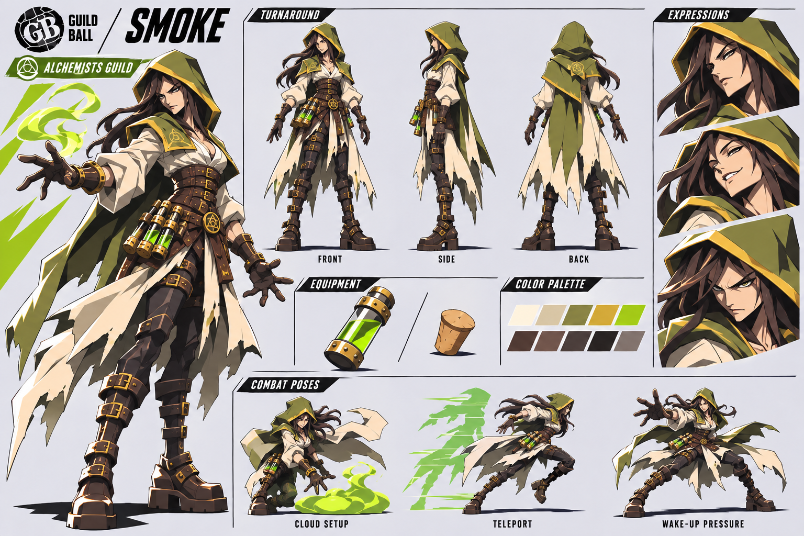

# Fight Guild

A Guild Ball character-based 1v1 fighting game concept, with **Guilty Gear Strive** as the closest gameplay and visual reference.

The project is currently in concept and visual development. The ball and sports mechanics are excluded. The starting roster is **Anvil, Smoke, Tapper, Shark, Fillet, and Hammer**.

## Current reference guides

These are the latest concept candidates, with weapons revised using miniature references. They are not yet approved production model sheets or actual 3D assets.

| Anvil | Smoke | Tapper |
| --- | --- | --- |
| [](art/characters/anvil.png) | [](art/characters/smoke.png) | [](art/characters/tapper.png) |

| Shark | Fillet | Hammer |
| --- | --- | --- |
| [](art/characters/shark.png) | [](art/characters/fillet.png) | [](art/characters/hammer.png) |

[Download the six-page reference PDF](exports/character-reference-guides.pdf).

## Project notes

- [Game concept and roster](docs/game-concept.md)
- [Visual direction and review criteria](docs/art-direction.md)
- [Miniature sources and equipment notes](references/README.md)
- [Earlier visual explorations](art/archive/README.md)
- [Asset provenance and checksums](art/asset-manifest.json)

## Repository layout

```text
art/characters/        Latest six character guides
art/archive/           Superseded concepts and earlier guide drafts
docs/                  Concept and visual direction notes
exports/               Combined reference PDF
references/miniatures/ Downloaded miniature reference images
references/sources.json Source URLs
```

The original user-created reference sheets were supplied in chat, but were not available as local source files when this repository was initialized. The generated guides and downloaded miniature references are included; the original uploaded sheets can be added separately.

Guild Ball characters, names, and source miniature images belong to their respective rights holders. This is an unofficial concept project. No license for third-party material is implied.
