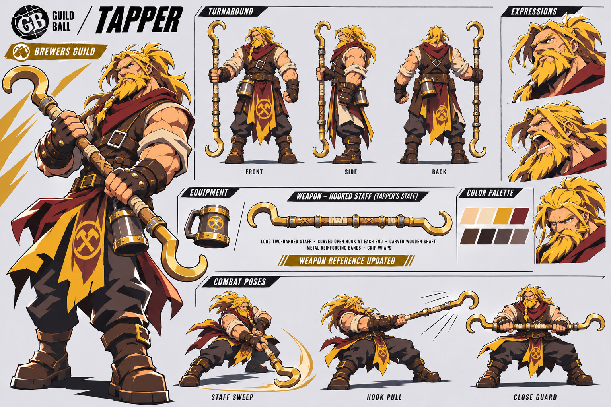
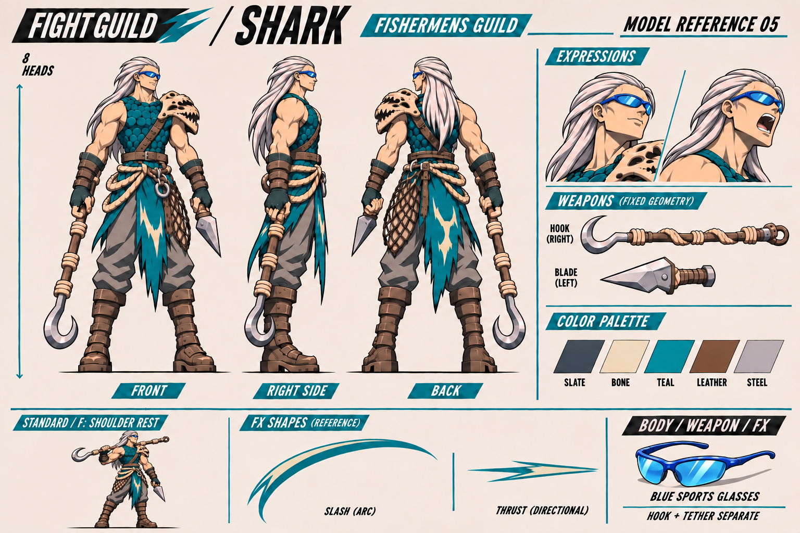

# Fight Guild

A native **Godot 4.6.3** fighting-game lab for iterating toward a PC/PS5 game. The PC build includes **Anvil, Hammer, Smoke, Tapper, Shark and Fillet**, generated sprites, all five basic **P / K / S / Hs / D** buttons, unified gatlings, a move editor, Momentum/Faultless Defense, counter/punish/reversal feedback and experimental direct rollback multiplayer.

Each fighter has matching **windup and active** pose studies plus movement poses and three two-frame block reactions. Open **Development → Sprite review** to compare actions at the same scale. These are provisional kits and images. The [sprite production contract](docs/sprite-production.md) and [backlog](docs/backlog.md) cover consistent palettes, silhouettes, smear shapes, future characters and eventual windup → active → impact → follow-through → recovery sequences.

Menus share the supplied **Guild Ball** visual language: Barlow Condensed, charcoal panels, raised blue controls and brass trim. Character select adds a central angled roster and large guild-colored fighters, following the requested 2XKO-inspired direction. The match HUD extends it with portrait nameplates, shaped health/Momentum rails, diamond Scrum markers and bold framed combat/announcer text. Menus use interruptible eased transitions, with a saved reduced-motion option. Controls uses its separate warm Settings skin. [Menu style and provenance](docs/menu-style.md) records the reusable assets and review workflow.

## Play or edit

Download the Windows/Linux ZIP from this branch's successful GitHub Actions artifacts, extract the whole folder and run its executable. For the editable project archive, import `godot/project.godot` in Godot 4.6.3. [Native play guide](docs/play-native.md) covers controls, saves, editing and direct online play.

- Versus is first to two Scrum wins: **1st Scrum**, **2nd Scrum**, and **Final Down** at 1–1. Fighter loading/intros and the four-beat opening lead into each match; online clients synchronize before release.
- Start from **Versus**, **Training** or **Development**, then choose fighters. Esc / gamepad Start opens the match menu. [Menu flow](docs/menu-flow.md) explains entry, pause, rematch and connection recovery.
- **Player 1:** WASD; J/K/L/I/O = P/K/S/Hs/D; Space = dash; left Shift = simple modifier; back + Q = Faultless Defense.
- **Player 2:** arrows; numpad 1/2/3/5/6 = attacks; numpad 0 = dash; numpad + = modifier; back + numpad Enter = Faultless Defense.
- Choose simplified inputs independently at fighter select. Traditional motions stay available.
- In **Development**, edit any fighter, Apply & reset, then Save locally or export JSON. Old schema-1/2/3 saves preserve edits during migration.
- Online: direct ENet/UDP host and join, default port 7000. Both players use Player 1 controls locally. Matching move data is required.

Momentum has **three equal sections**, with continuous gain and unchanged FD costs. Try **Start Momentum: 50%** and the **Faultless guard** dummy in training. The move editor exposes chip damage and **Guard break on block**; Sprite review includes negative/even, positive and guard-break clips. [Momentum and defense rules](docs/momentum-defense.md) describe the provisional tuning. Negative Penalty is deferred; FD is the only meter spend.

Combos now appear as large background numerals on the attacker's current side. **Attack loop** and **Guard → reversal** training dummies help test counter hits, recovery punishes and first-frame reversals. Counter-hit bonuses and reversal eligibility are editable per move. See [combo and timing rules](docs/combat-feedback.md).

## Develop on Linux

Needs Git, curl, Python 3 with pip, a C++17 compiler and standard Linux Godot runtime libraries. Setup installs a pinned editor if needed, SCons and godot-cpp bindings in `FIGHT_TOOLS`, then builds and tests. The cloud default is `/workspace/.fight-guild-tools`; elsewhere set `FIGHT_TOOLS` to an absolute writable path outside the checkout.

```bash
bash scripts/setup.sh
bash scripts/godot.sh --editor
# Or launch the game directly:
bash scripts/godot.sh
```

After C++ changes, run `bash scripts/build-godot.sh`. GDScript/data/art changes do not require recompiling the extension. Validate with `bash scripts/test-godot.sh`.

To export, install templates and build the Windows library with MinGW-w64 (setup builds the Linux library):

```bash
bash scripts/install-godot.sh --templates
bash scripts/build-godot.sh target=template_release
bash scripts/build-godot.sh platform=windows
bash scripts/build-godot.sh platform=windows target=template_release
bash scripts/export-godot.sh
```

`build/` receives Windows and Linux ZIPs plus an editable Godot project ZIP containing available extension binaries. `bash scripts/export-godot.sh Linux` packages only Linux. `mingw_prefix=/absolute/toolchain/prefix` selects a relocated MinGW toolchain. The template download is approximately 1.2 GB; only four PC templates are installed.

## Implementation and limits

The shared C++ core runs at 60 fixed ticks with integer state, independent of presentation. [Architecture](docs/combat-architecture.md) explains native instances, rollback, versioned data and future 3D integration. [Combat rules](docs/combat-rules.md) separates confirmed design from defaults.

Linux rendering, keyboard gameplay, all 30 basic attacks, editing, save migration, sprites, latency/jitter correction and two UDP processes are tested. Windows is cross-compiled/exported and needs hardware playtesting. PS5 requires approved console access and Godot port tooling; no PS5 build is included. Strive input-buffer parity is a future measurement task.

The browser harness is retained for regressions only: `bash scripts/setup-web.sh`, then `npm test`. Godot is the primary client and delivery path.

## Current reference guides

These are the latest concept candidates, with weapons revised using miniature references. They are not yet approved production model sheets or actual 3D assets.

| Anvil | Smoke | Tapper |
| --- | --- | --- |
| [](art/characters/anvil.png) | [](art/characters/smoke.png) | [](art/characters/tapper.png) |

| Shark | Fillet | Hammer |
| --- | --- | --- |
| [](art/characters/shark.png) | [](art/characters/fillet.png) | [](art/characters/hammer.png) |

[Download the six-page reference PDF](exports/character-reference-guides.pdf).

## Project notes

- [Game concept and roster](docs/game-concept.md)
- [Visual direction and review criteria](docs/art-direction.md)
- [Miniature sources and equipment notes](references/README.md)
- [Earlier visual explorations](art/archive/README.md)
- [Asset provenance and checksums](art/asset-manifest.json)

## Repository layout

```text
godot/                 Native project, UI, generated sprites and tests
native/                GDExtension adapter and build configuration
core/                  Deterministic C++ simulation
scripts/               Setup, build, tests and PC packaging
tests/                 Core, network and archived browser checks
docs/                  Rules, architecture, play guide and art pipeline backlog
art/characters/        Six source character reference guides
references/            Miniature sources and equipment notes
licenses/              Engine, dependencies and binding notices
web/                   Archived browser prototype
```

Guild Ball characters, names and miniature images belong to their respective rights holders. This is an unofficial concept project. No license for third-party material is implied.
