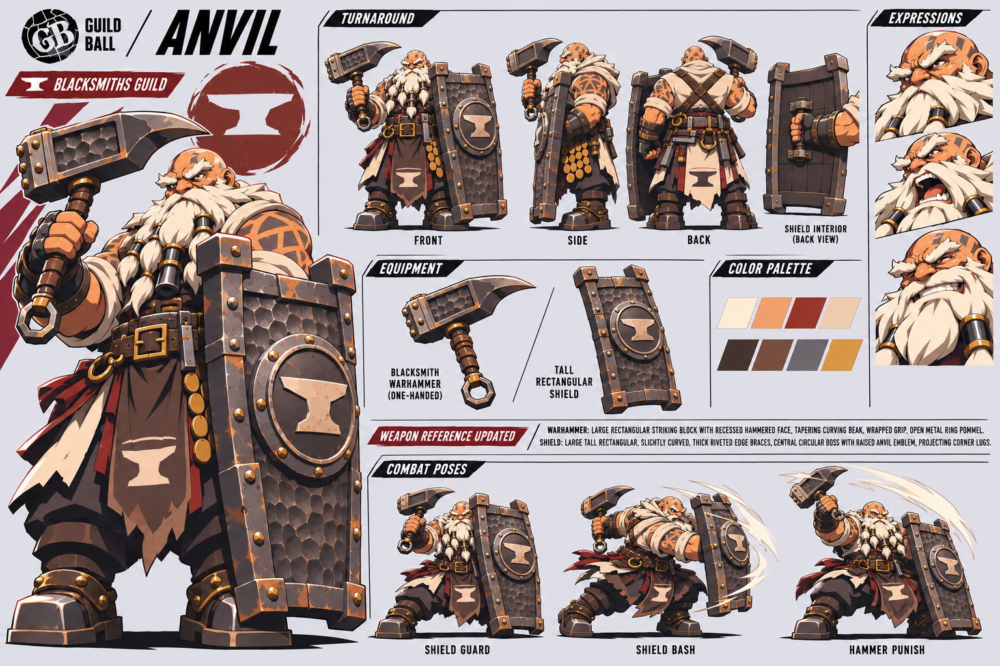

# Fight Guild

A Guild Ball character-based 1v1 fighting game concept, with **Guilty Gear Strive** as the closest gameplay and visual reference.

The project now has an initial **playable combat lab** alongside its concept art. The ball and sports mechanics are excluded. The starting roster is **Anvil, Smoke, Tapper, Shark, Fillet, and Hammer**; the lab uses original placeholder sprites and provisional kits for Anvil and Hammer.

## Play the combat lab

Build once, then open `build/FightGuild.html` in a current desktop Chrome or Edge browser. This standalone file includes the C++ combat core as WebAssembly and works without a server for local training, local versus, move editing, and simulated rollback checks.

For development on Linux or WSL, with Node 22+, Python 3, and a C++17 compiler:

```bash
bash scripts/setup.sh
npm start
```

The development server listens on port 8080 on the local machine. `npm run build` rebuilds the native tests, WebAssembly core, and standalone HTML. Set `FIGHT_TOOLS` to an absolute writable tools directory outside this checkout if `/workspace` is unavailable. Setup installs the pinned Zig compiler there. An installed `zig` can also be used; Zig 0.14.1 is the verified version.

- **Player 1:** WASD movement; J/K/L/I/O = P/K/S/Hs/D; Space = dash; left Shift = simplified-input modifier.
- **Player 2:** arrow movement; numpad 1/2/3/5/6 = P/K/S/Hs/D; numpad 0 = dash; numpad + = modifier.
- Standard gamepads are supported. See **Controls** in the lab for the mapping. Click the arena after editing to return keyboard focus to gameplay.
- Choose simplified inputs independently at fighter select. Traditional motions remain available. The initial shortcuts are modifier + forward/P, down/S, and up/Hs; direction is relative to facing.
- The move editor changes timing, damage, hitboxes, input mappings, and cancel options. **Apply & reset** tests changes immediately. **Save locally** persists in that browser; export JSON for a portable backup. Browser storage for files opened from disk varies, so keep exported backups.

## Validation

```bash
npm test
npm run test:browser
```

The first command builds and tests native C++, compares every frame of a native/WebAssembly trace, tests rollback under latency and jitter, validates move imports, and exercises two clients through the room relay. The browser smoke suite requires Chromium (`CHROMIUM_PATH` can select it); otherwise install Playwright's browser with `npx playwright install chromium`. Run `npm run build` before the browser suite to refresh the standalone artifact.

## Experimental online rooms

Run the repository server for room matches; the standalone HTML provides local play only. Two browser clients opening the same server can use **Host room** and **Join**. Both clients use Player 1 controls locally. Selection uses each client's Player 1 fighter and simple-input toggle. Move-data mismatches are rejected, editing is locked during a session, and confirmed simulation hashes are compared during play. The connection uses a WebSocket relay with rollback prediction and two frames of input delay.

For a trusted LAN, run `HOST=0.0.0.0 npm start` and connect both machines to that host's port 8080. The default binds only to the local machine. Public hosting, authentication, matchmaking, NAT traversal, platform services, and production network resilience are future work. A disconnect or exhausted rollback history requires a new room; online rematches currently require a new room too.

## Implementation status

The shared simulation is portable C++17, runs at 60 fixed steps per second, and has no engine dependency. The browser executes the same code as the native test runner. Presentation and the editor are separate JavaScript modules; they do not decide combat results. [Architecture](docs/combat-architecture.md) documents the state model and Unreal integration path. [Combat rules](docs/combat-rules.md) records confirmed decisions and provisional defaults.

This is an early PC browser prototype. Unreal integration, a packaged native PC game, and PS5 builds are not implemented. PS5 tooling and platform access remain prerequisites for console work. The input recognizer is original and configurable; exact Guilty Gear Strive input parity has not been established. Character mechanics, art, frame data, and game feel remain provisional. Throws, universal overheads, dedicated anti-air rules, meter, full aerial combat, and production animation are deferred.

## Current reference guides

These are the latest concept candidates, with weapons revised using miniature references. They are not yet approved production model sheets or actual 3D assets.

| Anvil | Smoke | Tapper |
| --- | --- | --- |
| [](art/characters/anvil.png) | [](art/characters/smoke.png) | [](art/characters/tapper.png) |

| Shark | Fillet | Hammer |
| --- | --- | --- |
| [](art/characters/shark.png) | [](art/characters/fillet.png) | [](art/characters/hammer.png) |

[Download the six-page reference PDF](exports/character-reference-guides.pdf).

## Project notes

- [Game concept and roster](docs/game-concept.md)
- [Visual direction and review criteria](docs/art-direction.md)
- [Miniature sources and equipment notes](references/README.md)
- [Earlier visual explorations](art/archive/README.md)
- [Asset provenance and checksums](art/asset-manifest.json)

## Repository layout

```text
art/characters/        Latest six character guides
art/archive/           Superseded concepts and earlier guide drafts
docs/                  Concept and visual direction notes
exports/               Combined reference PDF
references/miniatures/ Downloaded miniature reference images
references/sources.json Source URLs
core/                  Portable deterministic C++ combat simulation
web/                   Training interface, move editor, rollback session
scripts/               Build, standalone packaging, development/room server
tests/                 Native, WebAssembly, relay, and browser validation
```

The original user-created reference sheets were supplied in chat, but were not available as local source files when this repository was initialized. The generated guides and downloaded miniature references are included; the original uploaded sheets can be added separately.

Guild Ball characters, names, and source miniature images belong to their respective rights holders. This is an unofficial concept project. No license for third-party material is implied.
