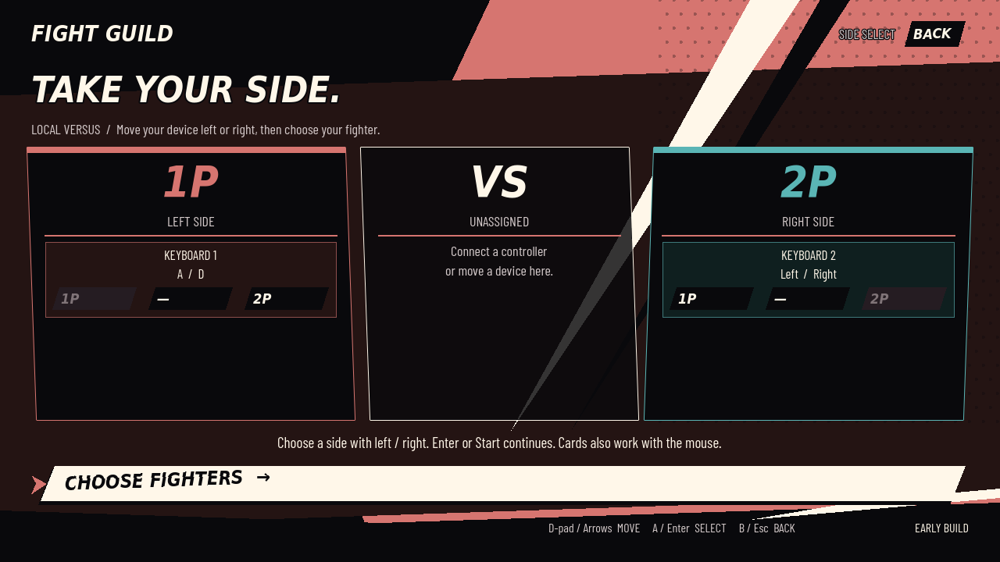
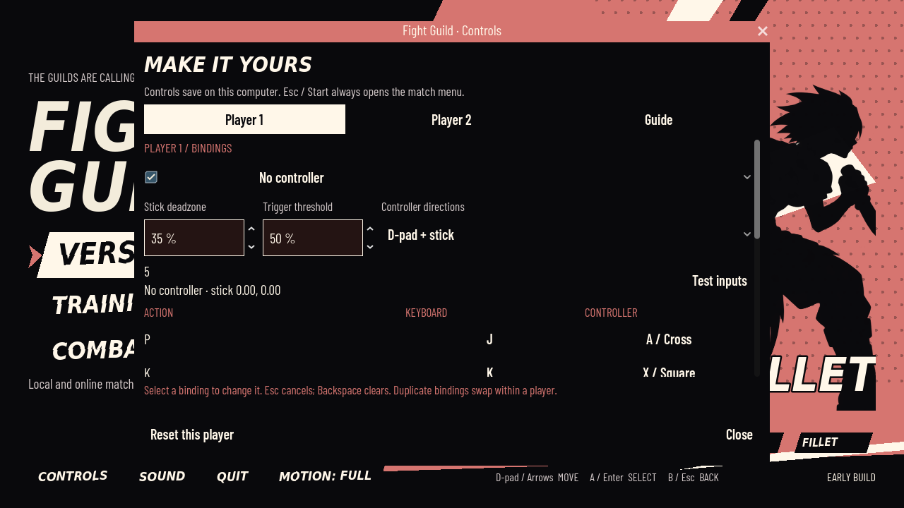

# Native controls and local side selection

The native game now provides saved remapping and a local side selector. These
changes do not update or publish the browser Move Workshop. Combat move JSON,
attack timings and the deterministic motion/action buffers remain separate from physical bindings. Simple inputs have been retired; specials and supers use motions.

## Choose your side

**Versus → Local versus → Choose your side → Fighter select.** Local Change
fighters also passes through this screen. Training and online retain their
existing selection paths; online always uses this computer's Player 1 controls.

The presentation uses the familiar Street Fighter-style left / neutral / right
controller-selection layout, with Fight Guild's own fonts, brass/teal sides and
menu surfaces. This is an implementation of that common interaction pattern,
not imported UI artwork or an exact reproduction of a particular game version.

- Move your controller's D-pad or left stick left/right between **1P**, the
  unassigned center and **2P**. A held stick moves only once until released.
- Each keyboard layout uses its current left/right bindings. The default pair
  is A/D for Keyboard 1, Left/Right arrows for Keyboard 2. Layouts can swap sides.
- Every device card also has **1P / — / 2P** mouse/focus buttons. A side accepts
  one keyboard layout and one controller; assigning another of the same type
  sends the previous one to the center.
- Both sides need an input before **Choose fighters** enables. Enter, Start or
  the focused button confirms. Esc/B goes back. Side changes are a draft until
  confirmation; canceling preserves live assignments and any paused round.
- Devices connected on this screen appear in the center. Disconnecting removes
  their cards and updates readiness. Fighter-select Back returns to side select;
  confirming again preserves keyboard layout swaps.

The side screen uses the existing menu transition and Reduced motion preference.
Device changes fade over 480 ms, or at most 90 ms with Reduced motion.

## Controls

Open **Controls** from Home, the match menu or the training/development header.
Choose **Player 1** or **Player 2**. The Guide tab explains motions and defense.

| Control | Behavior |
| --- | --- |
| Keyboard enabled | Enables or disables this player's keyboard layout, independently of their controller. |
| Controller picker | Automatic, No controller, or a connected device. Assigning the other player's controller removes it from that other player. |
| Stick deadzone | Activation threshold per axis, 10–90%; default 35%. Diagonals activate both axes. |
| Trigger threshold | Activation threshold, 10–90%; default 50%. |
| Controller directions | D-pad + stick, D-pad only, or Stick only. In combined mode, digital directions take precedence over the stick. |
| Keyboard / Controller binding | Select a field, then press a physical key, a controller button, or LT/L2 or RT/R2 on the assigned pad. |
| Test inputs | Captures controls without activating menu navigation or combat. Shows numpad direction, actions and live stick values. Esc/Start exits this test. |
| Reset this player | Restores that player's defaults. Keyboard keys already used by the other player stay unbound; the status line explains this. |

Esc cancels a pending binding; Backspace clears it. A duplicate binding **within
one player and input type** swaps the two actions. A key already bound to the
other player's layout is rejected with an explanation, even if that keyboard is
disabled. Esc and Start/Options stay reserved for the match menu; Guide and
unsupported pad buttons are not assignable. Menu navigation remains independent
of combat remapping. Button names include both Xbox and PlayStation equivalents.

Analog controls release below **80% of their activation threshold** to avoid
chattering around the edge. For example, the default stick engages beyond 0.35
and releases below 0.28. Both left+right and up+down neutralize before reaching
combat; opposed held inputs still count as held for menu release protection.

## Saving and device changes

`user://controls.json` stores the two profiles separately from `moves.json`. It
contains physical bindings, controller preference, keyboard toggles and analog
settings. A valid candidate is loaded atomically. Invalid files are preserved;
a save failure keeps the session's bindings usable and displays an explanation.
The training keyboard hint follows Player 1's current bindings. Loading an older control file clears its retired modifier slot; Shift, numpad + and LT/L2 can be remapped to other actions. The hidden slot remains unassignable so older recordings keep their bit positions.

Initial automatic assignment uses connected devices in order. Runtime ownership
then stays stable: removing Player 1's pad never shifts Player 2 into that slot.
The disconnected slot reserves its device identity; a matching reconnect can
reclaim it even if the numeric device ID changes. Explicit choices persist by
Godot controller GUID and name. Identical pads do not expose a unique hardware
identity here, so manual assignment may be needed after restarting. A different
replacement pad can always be selected in Controls.

A disconnect opens the match menu during play and clears held inputs. Offline
combat freezes there. An online match continues with neutral local input, with
that behavior stated in the disconnect message. Losing application focus also
neutralizes gameplay input and pauses an offline fight. Resume, new assignments
and closing settings require input release before combat accepts held controls.

## Verification and boundaries

- `tests/input_controls_test.gd`: all default keyboard/pad actions, remaps,
  duplicate/reserved controls, threshold hysteresis, direction modes, SOCD,
  stable hot-plug ownership, save/load and malformed data. Remapped keyboard and
  pad samples drive native 236/623 motions in both facings, retired-modifier compatibility, buffered
  recovery inputs and restored-history replay.
- `tests/input_menu_test.gd`: actual menu flow, physical input events, side swaps,
  neutral devices, cancel/back/confirm, reconnects, remap capture, offline pause,
  focus loss, settings input isolation and held-button resume protection.
- Existing `tests/core_test.cpp` verifies the parser's motion expiration,
  five-tick buffer/reversal boundaries, held-button behavior, FD consumption and
  replay. The existing native UI suite covers transitions, intros, match flow,
  keyboard/synthetic-controller navigation and local ENet behavior.
- `python scripts/capture-input-review.py` renders native 1280×720 previews and
  checks that the side-select action and Controls window fit. Test controllers
  are simulated and explicitly labeled in those screenshots.

The physical-binding layout is preserved: `FighterInputs` produces the same 12-bit
samples already used by recordings and rollback. The buffer remains the game's
configurable implementation, not verified Strive input parity. Windows gameplay,
physical controllers/fightsticks, platform-specific glyph detection and PS5
hardware remain separate validation work.
